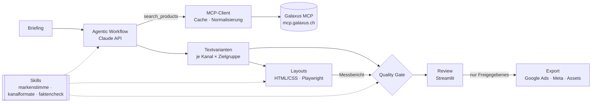

# Creative Automation Agent

> **Private Arbeitsprobe** von Ali Dlaimi auf Basis der öffentlichen Galaxus-MCP-Schnittstelle.
> Nicht offiziell von Digitec Galaxus und nicht mit Galaxus abgestimmt. Kein Galaxus-Logo, keine
> veröffentlichten Werbemittel; Produktbilder und gerenderte Werbemittel sind nicht im Repository.

Aus einem kurzen Kampagnen-Briefing entstehen Werbemittel-Varianten für Feed, Story, Banner und
Suchanzeige – mit **echten Produktdaten** über die Galaxus-MCP-Schnittstelle, in **modularen Layouts**,
geprüft von einem **Quality Gate**, bevor ein Mensch sie sieht. Freigabe und Export bleiben beim Menschen.

## Ergebnisse (Eval 20261124-0849, 14 Briefings, 48 Varianten)

| Messgrösse | Ergebnis |
|---|---|
| Faktenfehler, die eine menschliche Sichtung erreichen | **0** |
| Echte Faktenfehler des Generators (von Hand geprüft) | **0 von 48** |
| Negativtests vom Gate gestoppt | **16 / 16**, saubere Kontrollfälle frei 6 / 6 |
| Formate plattformkonform | **100 %** wie generiert, im Export garantiert |
| Fehlalarme des Gates | 3 von 48 (6 %) – analysiert, behoben, als Kontrollfälle festgehalten |
| Kosten | **rund 3 Rappen pro Variante** (USD 1.55 für 14 Briefings) |
| Zeit Briefing → geprüfte Varianten | Median **41 s** |
| Markenstimme-Bewertung vs. menschliches Urteil | 85 % Übereinstimmung, Kappa 0.48 (20 Texte, siehe Grenzen) |

Vollständiger Bericht mit Befunden: [eval/reports/20261124-0849.md](eval/reports/20261124-0849.md)

## Architektur



**Trennung von Daten, Regeln und Modell:** Produktdaten kommen nur aus der MCP-Schnittstelle, Regeln nur
aus Skills, das Modell formuliert. **Deterministisch, wo möglich:** Formate, Limits und Faktencheck sind
Code-Regeln; das Modell bewertet nur die Markenstimme – kalibriert und nur als Hinweis.

## Ablauf
1. **Briefing lesen** (Haiku): Suchbegriff, Preisrahmen, Kanäle, Zielgruppen.
2. **Recherche, agentisch** (Sonnet): bis zu 3 Suchen über MCP, Auswahl mit Begründung; nur IDs aus
   Suchergebnissen zulässig.
3. **Texte, strukturiert:** Ausgabeschema je Kanal aus dem Skill `kanalformate`; Budget und Zeitlimit pro Lauf.
4. **Layouts:** Bausteine (Bild, Name, Headline, Preis, CTA) je Format, gerendert mit Playwright; Preis und
   Name im Bild stammen aus den Produktdaten, nicht vom Modell. Messbericht: sichere Zone, Textanteil,
   Überlauf.
5. **Quality Gate:** Ampel mit Begründung und Quelle je Meldung.
6. **Review und Export:** Rot nicht freigebbar, gelb nur mit Begründung; Korrekturen laufen erneut durchs Gate.

## Skills
Versionierte Dateien unter `skills/`, ohne Code anpassbar, beim Laden gegen ein Schema geprüft
(Anleitung: [docs/playbook.md](docs/playbook.md)).

| Skill | Inhalt | Version |
|---|---|---|
| markenstimme | Haltung, Beispiele, No-Gos, Bewertungsrubrik – **eigene Ableitung**, durch echte Vorgaben ersetzbar | 1.0.1 |
| kanalformate | Masse, Zeichenlimits, sichere Zonen; jeder Wert mit offizieller Quelle, Status und Prüfdatum | 1.0.0 |
| faktencheck | Belegpflicht für Preise, Zahlen, Superlative; verbotene Rabatt-, Lager-, Lieferaussagen | 1.0.1 |

## 5-Minuten-Demo
```bash
uv run streamlit run src/creative_agent/review/app.py     # http://localhost:8501
```
1. **Neuer Lauf:** Briefing «Pendler-Kopfhörer bis CHF 200, Story und Feed, Zielgruppe Studierende» – echte
   Produkte über Galaxus-MCP, ca. 1 Minute.
2. **Varianten** in Feed und Story ansehen, «Sichere Zonen einblenden».
3. **Gate stoppt:** In einer Variante «Jetzt mit Rabatt» oder einen falschen Preis eintragen →
   «Korrigieren & neu prüfen» → 🔴 mit Begründung, Freigeben gesperrt.
4. **Freigabe** einer grünen Variante mit Begründung.
5. **Export** erstellen: Google-Ads-CSV (pausiert), Meta-CSV, PNGs und Manifest.

Ohne Netz: `uv run python -m creative_agent.mcp_client "Kopfhörer" --offline` (aufgezeichnete Daten).

## Setup
```bash
uv sync
uv run playwright install --with-deps chromium
cp .env.example .env            # ANTHROPIC_API_KEY eintragen, nie committen
uv run pytest -q                # ohne Netz, nur Fixtures
```
Docker: `docker build -t creative-automation-agent .` und
`docker run --rm -p 127.0.0.1:8501:8501 --env-file .env creative-automation-agent`

Weitere Befehle: `python -m creative_agent.workflow | layouts | gate | skills | evaluation` (jeweils `--help`).

## Evaluation
`uv run python -m creative_agent.evaluation negativ | kalibrieren | lauf --budget 3 | bericht <id>` –
Testset (15 Briefings), Negativtests, Kalibrierung der Markenstimme, versionierte Berichte mit Vergleich
zum Vorgänger. In GitHub Actions manuell auslösbar (Workflow «Eval», Budgetgrenze).

## Architecture Decision Records
| Nr. | Entscheid |
|---|---|
| [0001](docs/adr/0001-eigener-mcp-client.md) | Eigener MCP-Client statt MCP-Connector der Claude API |
| [0002](docs/adr/0002-datei-cache.md) | Datei-Cache für Antworten der Schnittstelle |
| [0003](docs/adr/0003-skill-format.md) | Skill-Format: SKILL.md + rules.yaml + CHANGELOG.md |
| [0004](docs/adr/0004-agentic-workflow.md) | Agentische Recherche, strukturiertes Texten |
| [0005](docs/adr/0005-rendering-html-playwright.md) | Layouts als HTML/CSS, gerendert mit Playwright |
| [0006](docs/adr/0006-quality-gate.md) | Quality Gate: Regeln vor Modell, Ampel mit Begründung |
| [0007](docs/adr/0007-review-und-export.md) | Review mit Freigaberegeln, Export nur von Freigegebenem |
| [0008](docs/adr/0008-evaluation-und-kalibrierung.md) | Evaluation und Kalibrierung der Markenstimme |

Quellen zur Schnittstelle: [docs/quellen/galaxus-mcp.md](docs/quellen/galaxus-mcp.md) ·
Governance: [docs/governance.md](docs/governance.md)

## Grenzen
- Der Faktencheck prüft Zahlen, Preise, Superlative und Begriffe – **keine qualitativen Behauptungen**.
  Diese fängt nur die menschliche Review.
- Die Markenstimme ist eine eigene Ableitung; kalibriert an 20 Texten und den Urteilen einer Person.
  Die Schwelle wurde nach Ansicht der Daten gewählt – die Übereinstimmung ist eher optimistisch.
- Testset klein (15 Briefings); Kennzahlen sind Hinweise, nicht statistisch belastbar.
- Die Schnittstelle liefert keine Rabatte, Lagerbestände oder Lieferzeiten – solche Aussagen sind gesperrt.
- Google-Ads-Export folgt der CSV-Spaltenreferenz des Ads Editors; der Import ist einmal im Editor zu verifizieren.
- Prototyp ohne Anmeldung, Rollen und Mehrbenutzerbetrieb.

## Nächste Schritte
- **Bildgenerierung** für Hintergründe und Szenen, mit eigenem Gate (Produkttreue, Rechte).
- **Anbindung an ein DAM** für freigegebene Bilder und Markenelemente statt Shop-Vorschaubilder.
- **Performance-Rückfluss** aus Google Ads und Meta: welche Ideen wirken – als Input für Skills und Auswahl.
- Kalibrierung mit mehreren Personen aus dem Kreationsteam und frischen Texten; echte Markenvorgaben als
  Skill-Version 2.0.
